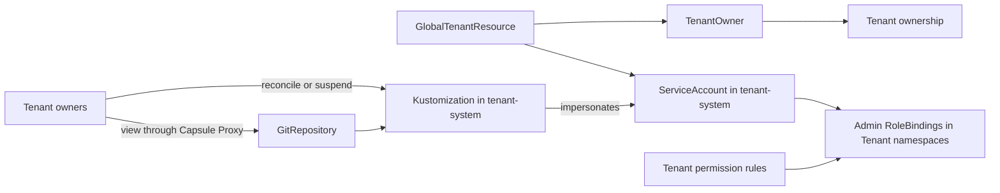

[Flux](https://fluxcd.io/) can reconcile each Tenant's Git repository using a dedicated ServiceAccount. Capsule makes that account a Tenant owner and distributes its permissions to the Tenant's namespaces. Tenant owners can see their Flux resources through Capsule Proxy and request reconciliation or suspend deployment.

The example uses a shared, platform-owned `tenant-system` namespace **outside every Tenant**. Solar gets `tenant-system/flux-solar`; Wind gets a different account. Neither Tenant administers this namespace.



## Prerequisites

Run platform setup as a cluster administrator. You need:

* Capsule with `TenantOwner`, Tenant permission rules, and [GlobalTenantResource generators with `scope: Tenant`](/docs/replications/global/#generators).
* [Capsule Proxy](/docs/proxy/) configured in the kubeconfig files used by Tenant users. Install Flux CRDs before starting the proxy so discovery includes them; restart the proxy after adding these APIs if needed.
* Flux watching `tenant-system`, with `source.toolkit.fluxcd.io/v1` `GitRepository` and `kustomize.toolkit.fluxcd.io/v1` `Kustomization` APIs. The Kustomize controller must be allowed to impersonate the reconciliation accounts.
* Flux's standard RBAC aggregation into `admin`, or equivalent `list` permissions for Flux resources in every Tenant namespace. Capsule Proxy uses those permissions to authorize the Tenant's filtered collection view.
* Kubernetes 1.30 or later with `admissionregistration.k8s.io/v1` `ValidatingAdmissionPolicy` enabled for the delegation guard below.
* `kubectl`, and optionally the Flux CLI.

## Run Flux safely in a shared cluster

Before connecting Tenant repositories, follow Flux's official [multi-tenancy lockdown guide](https://fluxcd.io/flux/installation/configuration/multitenancy/). Use its controller configuration for your installed Flux version. Capsule's namespace ownership and permission rules work alongside Flux's own authorization controls.

The upstream guide covers the settings needed for these examples:

* Disable cross-namespace Flux references with `--no-cross-namespace-refs=true` on the relevant controllers.
* Disable Kustomize remote bases with `--no-remote-bases=true`.
* Configure `--default-service-account=default` for the Kustomize and Helm controllers, and leave that fallback account without reconciliation privileges. Each Tenant Kustomization or HelmRelease must explicitly select its authorized account with `spec.serviceAccountName`.
* Keep privileged platform reconciliation and its source repositories under platform administrator control.

These restrictions concern Flux source and object references across namespaces; they do not prevent an authorized reconciliation account from deploying into several namespaces of its Capsule Tenant. Both integration patterns below keep each Flux object and its source in the same namespace.

Several Tenants share `tenant-system` in the first pattern. Flux's namespace reference restriction does not isolate objects **within that shared namespace**: keep their definitions platform-managed and apply the [delegation guard](#limit-delegated-changes-to-reconcile-and-suspend) before granting owners patch access. In the HelmRelease pattern, the source, release, and promoted account live inside the Tenant instead.

Refer to Flux's [security best practices](https://fluxcd.io/flux/security/best-practices/) for the wider deployment configuration and its [multi-tenancy example repository](https://github.com/fluxcd/flux2-multi-tenancy) for platform and Tenant repository layouts.

## Prepare the platform namespace

Save this as `flux-platform.yaml`. The `capsule-flux-bootstrap` account runs the GlobalTenantResource; it is separate from the accounts Flux impersonates when applying Tenant workloads.

```yaml
apiVersion: v1
kind: Namespace
metadata:
  name: tenant-system
---
apiVersion: v1
kind: ServiceAccount
metadata:
  name: capsule-flux-bootstrap
  namespace: tenant-system
automountServiceAccountToken: false
---
apiVersion: rbac.authorization.k8s.io/v1
kind: Role
metadata:
  name: capsule-flux-bootstrap
  namespace: tenant-system
rules:
  - apiGroups: [""]
    resources: ["serviceaccounts"]
    verbs: ["get", "list", "create", "patch", "delete"]
  - apiGroups: ["rbac.authorization.k8s.io"]
    resources: ["roles", "rolebindings"]
    verbs: ["get", "list", "create", "update", "patch", "delete"]
  - apiGroups: ["rbac.authorization.k8s.io"]
    resources: ["roles"]
    verbs: ["bind", "escalate"]
  - apiGroups: ["source.toolkit.fluxcd.io"]
    resources: ["gitrepositories"]
    verbs: ["get", "list", "create", "patch", "delete"]
  - apiGroups: ["kustomize.toolkit.fluxcd.io"]
    resources: ["kustomizations"]
    verbs: ["get", "list", "create", "patch", "delete"]
---
apiVersion: rbac.authorization.k8s.io/v1
kind: RoleBinding
metadata:
  name: capsule-flux-bootstrap
  namespace: tenant-system
roleRef:
  apiGroup: rbac.authorization.k8s.io
  kind: Role
  name: capsule-flux-bootstrap
subjects:
  - kind: ServiceAccount
    name: capsule-flux-bootstrap
    namespace: tenant-system
---
apiVersion: rbac.authorization.k8s.io/v1
kind: ClusterRole
metadata:
  name: capsule-flux-bootstrap
rules:
  - apiGroups: ["capsule.clastix.io"]
    resources: ["tenantowners"]
    verbs: ["get", "list", "create", "patch", "delete"]
---
apiVersion: rbac.authorization.k8s.io/v1
kind: ClusterRoleBinding
metadata:
  name: capsule-flux-bootstrap
roleRef:
  apiGroup: rbac.authorization.k8s.io
  kind: ClusterRole
  name: capsule-flux-bootstrap
subjects:
  - kind: ServiceAccount
    name: capsule-flux-bootstrap
    namespace: tenant-system
```

```bash
kubectl apply -f flux-platform.yaml
```

`bind` and `escalate` allow this platform identity to generate the Roles and RoleBindings below. Creating TenantOwners also grants ownership, so keep this identity and its RBAC under administrator control. Tenant owners receive no access to ServiceAccounts, tokens, Secrets, or RBAC in `tenant-system`.

## Grant the reconciliation account access to Tenant namespaces

Save this as `solar-tenant.yaml`. For an existing Tenant, merge the label and rule into its current definition, preserving its owners and other rules.

```yaml
apiVersion: capsule.clastix.io/v1beta2
kind: Tenant
metadata:
  name: solar
  labels:
    gitops.example.com/enabled: "true"
spec:
  owners:
    - kind: User
      name: alice
  rules:
    - permissions:
        bindings:
          - clusterRoleName: admin
            subjects:
              - kind: ServiceAccount
                name: flux-{{ .tenant.metadata.name }}
                namespace: tenant-system
```

```bash
kubectl apply -f solar-tenant.yaml
```

With no `namespaceSelector`, Capsule creates the `admin` RoleBinding in every current and future namespace belonging to Solar. This is namespaced administration, not a `cluster-admin` grant. Add namespace selectors when different namespace profiles need different access.

Use `permissions.bindings` for this external account: `permissions.promotions` discovers labelled ServiceAccounts inside the selected Tenant namespaces and will not discover an account in `tenant-system`. Ownership is established separately by the TenantOwner below. See [Tenant permission rules](/docs/tenants/rules/#permissions).

## Generate identities and owner permissions

Save this as `flux-tenants.yaml`. One GlobalTenantResource creates an account, a TenantOwner, and a named Role and RoleBinding per enabled Tenant. It runs once per Tenant, even when the Tenant has no namespaces yet.

Before applying this GlobalTenantResource, install the [delegation guard](#limit-delegated-changes-to-reconcile-and-suspend).

```yaml
apiVersion: capsule.clastix.io/v1beta2
kind: GlobalTenantResource
metadata:
  name: flux-tenants
spec:
  scope: Tenant
  resyncPeriod: 60s
  serviceAccount:
    name: capsule-flux-bootstrap
    namespace: tenant-system
  tenantSelector:
    matchLabels:
      gitops.example.com/enabled: "true"
  resources:
    - policy:
        creation: Owner
        protect: true
        deletion: Remove
      generators:
        - missingKey: error
          template: |
            apiVersion: v1
            kind: ServiceAccount
            metadata:
              name: flux-{{ $.tenant.metadata.name }}
              namespace: tenant-system
              labels:
                projectcapsule.dev/tenant: {{ $.tenant.metadata.name | quote }}
            automountServiceAccountToken: false
            ---
            apiVersion: capsule.clastix.io/v1beta2
            kind: TenantOwner
            metadata:
              name: flux-{{ $.tenant.metadata.name }}
              labels:
                projectcapsule.dev/tenant: {{ $.tenant.metadata.name | quote }}
            spec:
              kind: ServiceAccount
              name: system:serviceaccount:tenant-system:flux-{{ $.tenant.metadata.name }}
              clusterRoles: []
              aggregate: true
            ---
            apiVersion: rbac.authorization.k8s.io/v1
            kind: Role
            metadata:
              name: flux-{{ $.tenant.metadata.name }}-owners
              namespace: tenant-system
            rules:
              - apiGroups: ["source.toolkit.fluxcd.io"]
                resources: ["gitrepositories"]
                resourceNames: ["flux-{{ $.tenant.metadata.name }}"]
                verbs: ["get"]
              - apiGroups: ["kustomize.toolkit.fluxcd.io"]
                resources: ["kustomizations"]
                resourceNames: ["flux-{{ $.tenant.metadata.name }}"]
                verbs: ["get", "patch"]
            {{- $owners := $.tenant | get "status" | default (dict) | get "owners" | default (list) }}
            {{- if $owners }}
            ---
            apiVersion: rbac.authorization.k8s.io/v1
            kind: RoleBinding
            metadata:
              name: flux-{{ $.tenant.metadata.name }}-owners
              namespace: tenant-system
            roleRef:
              apiGroup: rbac.authorization.k8s.io
              kind: Role
              name: flux-{{ $.tenant.metadata.name }}-owners
            subjects:
            {{- range $owners }}
            {{- if eq .kind "ServiceAccount" }}
              - kind: ServiceAccount
                name: {{ index (splitList ":" .name) 3 | quote }}
                namespace: {{ index (splitList ":" .name) 2 | quote }}
            {{- else }}
              - kind: {{ .kind }}
                apiGroup: rbac.authorization.k8s.io
                name: {{ .name | quote }}
            {{- end }}
            {{- end }}
            {{- end }}
```

```bash
kubectl apply -f flux-tenants.yaml
kubectl wait --for=condition=Ready --timeout=120s globaltenantresource/flux-tenants
kubectl wait --for=condition=Ready --timeout=120s tenantowner/flux-solar
kubectl get tenant solar -o jsonpath='{.status.owners}'
kubectl -n tenant-system get rolebinding flux-solar-owners -o yaml
```

The `projectcapsule.dev/tenant: solar` label assigns the TenantOwner to Solar without a `matchOwners` selector. `aggregate: true` also registers the account as a Capsule user. Its empty `clusterRoles` list leaves workload permissions to the Tenant rule rather than the default owner roles.

The generated RoleBinding follows **effective** `tenant.status.owners`, including users, groups, and ServiceAccounts. It refreshes as the replication reconciles; wait until the subjects reflect the intended owners before testing access or considering a revocation complete. A ServiceAccount owner uses its Kubernetes name and namespace in the RoleBinding, rather than its full authentication username.

## Connect a Tenant repository

Create the Flux resources manually as a platform administrator. Save this as `solar-flux.yaml`, replacing the URL, branch, and path with the Tenant's repository settings. The path must contain a Kustomize configuration whose namespaced manifests target Solar namespaces that already exist. Omit `targetNamespace` to allow manifests in several Solar namespaces.

```yaml
apiVersion: source.toolkit.fluxcd.io/v1
kind: GitRepository
metadata:
  name: flux-solar
  namespace: tenant-system
  labels:
    projectcapsule.dev/tenant: solar
    capsule.clastix.io/managed-by: solar
spec:
  interval: 1m
  url: https://github.com/example/solar-gitops.git
  ref:
    branch: main
---
apiVersion: kustomize.toolkit.fluxcd.io/v1
kind: Kustomization
metadata:
  name: flux-solar
  namespace: tenant-system
  labels:
    projectcapsule.dev/tenant: solar
    capsule.clastix.io/managed-by: solar
spec:
  interval: 5m
  path: ./clusters/production
  prune: true
  serviceAccountName: flux-solar
  sourceRef:
    kind: GitRepository
    name: flux-solar
```

```bash
kubectl apply -f solar-flux.yaml
kubectl -n tenant-system wait --for=condition=Ready --timeout=120s gitrepository/flux-solar
kubectl -n tenant-system wait --for=condition=Ready --timeout=120s kustomization/flux-solar
```

Flux impersonates `tenant-system/flux-solar` to apply the repository's workloads. The account has namespace administration only where Capsule has bound it; manifests targeting another Tenant's namespaces must fail authorization. For private repositories, provision a separate read-only Git credential Secret in `tenant-system` and reference it with `GitRepository.spec.secretRef.name`. Keep credentials under platform control. See the Flux [GitRepository documentation](https://fluxcd.io/flux/components/source/gitrepositories/).

The labels have different purposes:

| Label | Purpose |
| --- | --- |
| `projectcapsule.dev/tenant: solar` | Assigns the TenantOwner and identifies the Tenant on generated resources. |
| `capsule.clastix.io/managed-by: solar` | Selects the Flux resources for Capsule Proxy's generic namespaced collection filtering. Keep this compatibility label on both Flux resources for that proxy path. |

Labels do not grant Kubernetes RBAC permissions. The proxy's filtered collection view and the named Role grants work together: users list their resources through the proxy, then use explicit `get` and `patch` permissions on their own named objects. Do not grant `list` on the whole shared namespace or substitute a `GlobalProxySettings.clusterResources` rule, which is for cluster-scoped resources.

## View, reconcile, and suspend

Run these commands with Alice's kubeconfig pointing to Capsule Proxy:

```bash
kubectl get gitrepositories.source.toolkit.fluxcd.io --all-namespaces
kubectl get kustomizations.kustomize.toolkit.fluxcd.io --all-namespaces
kubectl -n tenant-system get kustomization flux-solar
flux reconcile kustomization flux-solar --namespace tenant-system
flux suspend kustomization flux-solar --namespace tenant-system
flux resume kustomization flux-solar --namespace tenant-system
```

The reconcile command uses the current source artifact. `--with-source` additionally patches the GitRepository and is intentionally outside the read-only source permission in this example. Request a source refresh through the platform or wait for its interval. Reconciliation requests set `reconcile.fluxcd.io/requestedAt`; suspend and resume change `spec.suspend`. See Flux's [reconciliation and suspension examples](https://fluxcd.io/flux/components/kustomize/kustomizations/#triggering-a-reconcile).

Verify the persisted `spec.suspend` value after suspending and resuming. Suspension pauses future reconciliation; it does not remove deployed workloads.

Repeat setup for a second Tenant such as Wind with a different owner and repository. Verify that:

* Alice's collection results include Solar's Flux resources and exclude Wind's.
* Alice can reconcile, suspend, and resume `flux-solar`, with status reflecting the requested operation.
* Alice cannot get or patch `tenant-system/flux-wind` and cannot read Secrets or mint ServiceAccount tokens in `tenant-system`.
* An attempted patch of `flux-solar.spec.serviceAccountName`, `sourceRef`, or its Tenant labels is denied by `capsule-flux-delegation`, with the stored object unchanged.
* A Solar repository change targeting a Wind namespace fails with the expected authorization error and leaves Wind unchanged.

## Automate the Flux definitions too

For new Tenants, the same GlobalTenantResource can also generate the GitRepository and Kustomization. Store their repository settings in [Tenant data](/docs/operating/concepts/templating/#data):

```yaml
spec:
  data:
    flux:
      url: https://github.com/example/solar-gitops.git
      branch: main
      path: ./clusters/production
```

Append this block to `spec.resources` in `flux-tenants.yaml` before adding those Tenants:

```yaml
- policy:
    creation: Owner
    protect: false
    deletion: Remove
  generators:
    - missingKey: error
      template: |
        apiVersion: source.toolkit.fluxcd.io/v1
        kind: GitRepository
        metadata:
          name: flux-{{ $.tenant.metadata.name }}
          namespace: tenant-system
          labels:
            projectcapsule.dev/tenant: {{ $.tenant.metadata.name | quote }}
            capsule.clastix.io/managed-by: {{ $.tenant.metadata.name | quote }}
        spec:
          interval: 1m
          url: {{ $.tenant.spec.data.flux.url | quote }}
          ref:
            branch: {{ $.tenant.spec.data.flux.branch | quote }}
        ---
        apiVersion: kustomize.toolkit.fluxcd.io/v1
        kind: Kustomization
        metadata:
          name: flux-{{ $.tenant.metadata.name }}
          namespace: tenant-system
          labels:
            projectcapsule.dev/tenant: {{ $.tenant.metadata.name | quote }}
            capsule.clastix.io/managed-by: {{ $.tenant.metadata.name | quote }}
        spec:
          interval: 5m
          path: {{ $.tenant.spec.data.flux.path | quote }}
          prune: true
          serviceAccountName: flux-{{ $.tenant.metadata.name }}
          sourceRef:
            kind: GitRepository
            name: flux-{{ $.tenant.metadata.name }}
```

Provide `spec.data.flux` for every Tenant selected by the replication before adding this block. `creation: Owner` expects absent objects or objects already managed by this replication; adopting manually created definitions requires a deliberate [Merge policy](/docs/operating/concepts/managed-resources/#resource-policy).

`protect: false` allows the delegated Kustomization patches; the admission guard still limits their fields. Keep `spec.suspend` and the reconcile request annotation out of the generator so replication does not continually reset the owner's actions. The identity and RBAC block remains protected. Bootstrap and repository settings stay platform-managed, while namespace permission rules continue to define where each reconciliation account can act.

Deleting the replication or deselecting a Tenant removes its generated objects with `deletion: Remove`. When Flux definitions are generated too, deleting a Kustomization with `prune: true` can delete its workloads. Review Flux's deletion behavior before removing a Tenant from this integration; manually created Flux definitions require separate cleanup. Remove the Tenant's reconciliation-account binding rule when retiring the integration.

## Let a Tenant HelmRelease create namespaces

Tenant owners can also run their own HelmRelease inside a Tenant namespace. When its chart creates additional namespaces, the Helm reconciliation account needs Tenant ownership as well as permissions to apply namespaced resources. A namespace `admin` RoleBinding alone does not authorize namespace creation.

Apply the [Flux multi-tenancy configuration](#run-flux-safely-in-a-shared-cluster) to the Helm controller too. Owner promotion grants the selected account Tenant access; it does not configure the controller's fallback identity or restrictions on source references.

For this pattern, create the account in `solar-system`, a namespace **belonging to Solar**. This differs from the platform-owned `tenant-system` namespace used earlier: label-based owner promotion discovers accounts inside the Tenant's namespaces. No separate TenantOwner object is needed for this account.

### Route Helm's API requests through Capsule Proxy

Configure the Helm controller's Kubernetes client to use Capsule Proxy. Helm checks whether a chart's resources already exist before creating them. A direct API request for a missing namespace can return `Forbidden` before Capsule has created its RoleBindings; the proxy provides the namespace lookup behavior needed here. Configuring Alice's kubeconfig alone does not change the controller's connection.

For a controller using the in-cluster client, the following deployment patch redirects it to `capsule-proxy.capsule-system.svc:9001`. Adjust the endpoint for your [proxy installation](/docs/proxy/setup/installation/). As a platform administrator, first save the trusted proxy CA certificate as `capsule-proxy-ca.crt` and create its ConfigMap:

```bash
kubectl -n flux-system create configmap capsule-proxy-ca \
  --from-file=ca.crt=./capsule-proxy-ca.crt \
  --dry-run=client -o yaml | kubectl apply -f -
```

Save this patch as `helm-controller-proxy.yaml` and include it in the platform's Flux installation configuration so Git reconciliation preserves it:

```yaml
apiVersion: apps/v1
kind: Deployment
metadata:
  name: helm-controller
  namespace: flux-system
spec:
  template:
    spec:
      containers:
        - name: manager
          env:
            - name: KUBERNETES_SERVICE_HOST
              value: capsule-proxy.capsule-system.svc
            - name: KUBERNETES_SERVICE_PORT
              value: "9001"
          volumeMounts:
            - name: capsule-proxy-ca
              mountPath: /var/run/secrets/kubernetes.io/serviceaccount/ca.crt
              subPath: ca.crt
              readOnly: true
      volumes:
        - name: capsule-proxy-ca
          configMap:
            name: capsule-proxy-ca
```

For an immediate application of that same patch:

```bash
kubectl -n flux-system patch deployment helm-controller \
  --type=strategic --patch-file helm-controller-proxy.yaml
kubectl -n flux-system rollout status deployment/helm-controller
```

The projected ServiceAccount token remains in place; only its CA file is overlaid. Restart the controller after updating this CA ConfigMap because a `subPath` mount does not receive ConfigMap updates. The proxy must trust the controller's authentication and permit its authorized impersonation requests.

### Enable promotion and define namespace permissions

As a platform administrator, enable ServiceAccount promotion in the existing CapsuleConfiguration, preserving its other settings. Replace `default` if your configuration has another name:

```bash
kubectl patch capsuleconfiguration default --type=merge \
  --patch '{"spec":{"allowServiceAccountPromotion":true}}'
```

Merge the following into Solar's Tenant definition, preserving its owners and existing rules:

```yaml
spec:
  permissions:
    allowOwnerPromotion: true
  rules:
    - permissions:
        promotions:
          - clusterRoles: ["admin"]
            selector:
              matchLabels:
                app.kubernetes.io/name: helm-reconciler
```

This rule grants matching, promoted accounts `admin` in every current and future Solar namespace. Add a `namespaceSelector` if only selected namespace profiles should receive that access; the namespace containing the account must also match for rule-based discovery. The ClusterRoles configured in `CapsuleConfiguration.spec.rbac.promotionClusterRoles` apply independently to owner promotion. Keep the namespace provisioning permissions required by your Capsule installation. See [owner promotion](/docs/tenants/permissions/#owner-promotion) and [rule-based promotion](/docs/tenants/rules/#promotions).

Ensure `solar-system` exists and belongs to Solar before creating the account. For example, a platform administrator can apply:

```yaml
apiVersion: v1
kind: Namespace
metadata:
  name: solar-system
  labels:
    capsule.clastix.io/tenant: solar
```

### Promote the Helm reconciliation account

As Alice, or another existing Solar owner, apply `solar-helm-account.yaml`:

```yaml
apiVersion: v1
kind: ServiceAccount
metadata:
  name: helm-reconciler
  namespace: solar-system
  labels:
    app.kubernetes.io/name: helm-reconciler
    owner.projectcapsule.dev/promote: "true"
    projectcapsule.dev/promote: "true"
automountServiceAccountToken: false
```

```bash
kubectl apply -f solar-helm-account.yaml
kubectl get tenant solar -o jsonpath='{.status.owners}'
kubectl get tenant solar -o jsonpath='{.status.promotions}'
kubectl -n solar-system get rolebindings -o yaml
```

The two promotion labels have separate purposes:

| Label | Effect |
| --- | --- |
| `owner.projectcapsule.dev/promote: "true"` | Makes the account an owner of the Tenant containing its namespace, allowing Tenant namespace creation under Capsule's admission policies. |
| `projectcapsule.dev/promote: "true"` | Makes the account eligible for the Tenant rule above, which distributes namespaced `admin` permissions. |

Wait until `system:serviceaccount:solar-system:helm-reconciler` appears in Solar's effective owners and promotions, and the corresponding `admin` RoleBinding exists in `solar-system`, before creating the HelmRelease. The Helm controller must be allowed to impersonate the account. Promotion must be performed by an existing authorized owner; do not rely on the account promoting itself during chart installation.

### Put namespace definitions in the chart

In the Tenant's Git repository, create `charts/tenant-namespaces/Chart.yaml`:

```yaml
apiVersion: v2
name: tenant-namespaces
description: Namespaces managed by the Solar Tenant
type: application
version: 0.1.0
```

Create `charts/tenant-namespaces/templates/namespaces.yaml`:

```go-template
{{- range .Values.namespaces }}
apiVersion: v1
kind: Namespace
metadata:
  name: {{ . | quote }}
  labels:
    capsule.clastix.io/tenant: {{ $.Values.tenant | quote }}
  annotations:
    helm.sh/resource-policy: keep
---
{{- end }}
```

The explicit Tenant label supports Capsule's label-based namespace assignment. Prefix, namespace quota, and other namespace policies still apply. The `keep` annotation retains these namespaces when the Helm release is uninstalled; clean them up deliberately when they are no longer needed.

This example chart creates only namespaces. Capsule reconciles their namespace profiles and RoleBindings asynchronously, so wait for those permissions before deploying workloads into a newly created namespace.

### Reconcile the chart using the promoted account

Save this as `solar-helm.yaml`, replacing the repository URL. Keep the source in the same namespace as the HelmRelease to work with Flux's cross-namespace reference restrictions:

```yaml
apiVersion: source.toolkit.fluxcd.io/v1
kind: GitRepository
metadata:
  name: tenant-workloads
  namespace: solar-system
spec:
  interval: 1m
  url: https://github.com/example/solar-gitops.git
  ref:
    branch: main
---
apiVersion: helm.toolkit.fluxcd.io/v2
kind: HelmRelease
metadata:
  name: tenant-namespaces
  namespace: solar-system
spec:
  interval: 5m
  serviceAccountName: helm-reconciler
  targetNamespace: solar-system
  storageNamespace: solar-system
  chart:
    spec:
      chart: ./charts/tenant-namespaces
      interval: 1m
      sourceRef:
        kind: GitRepository
        name: tenant-workloads
  values:
    tenant: solar
    namespaces:
      - solar-preview
```

```bash
kubectl apply -f solar-helm.yaml
kubectl -n solar-system wait --for=condition=Ready --timeout=120s helmrelease/tenant-namespaces
kubectl get namespace solar-preview -o yaml
kubectl -n solar-preview get rolebindings -o yaml
```

Confirm that the persisted namespace belongs to Solar and receives the expected profile and `admin` binding for `helm-reconciler`. Changing the chart to claim a namespace for another Tenant must be rejected by Capsule. Owner promotion does not grant `cluster-admin` or permission to install arbitrary cluster-scoped resources such as CRDs and ClusterRoles.

Flux also supports `spec.install.createNamespace: true` for a missing target namespace. That option synthesizes a namespace without the explicit Tenant label shown above, so it requires a compatible Capsule namespace assignment configuration, such as enforced Tenant prefixes. Use chart-defined, labelled namespaces for the label-based assignment pattern in this guide. See the Flux [HelmRelease reference](https://fluxcd.io/flux/components/helm/helmreleases/).

To revoke both promotions, remove both labels and update any Git manifest that would restore them:

```bash
kubectl -n solar-system label serviceaccount helm-reconciler \
  owner.projectcapsule.dev/promote- projectcapsule.dev/promote-
```

Wait until the account disappears from Solar's effective owners and promotions and the generated grants are removed. Revocation does not delete namespaces or deployed resources, and subsequent Helm reconciliation can fail until an authorized replacement account is configured.

## Limit delegated changes to reconcile and suspend

Kubernetes RBAC cannot grant permission to patch just one field. Without admission validation, permission to suspend a Kustomization also permits changing `spec.serviceAccountName` to another Tenant's account in the shared namespace.

Save this as `flux-delegation-guard.yaml` and apply it **before granting Tenant owners patch access**. It permits changes to `spec.suspend` and the reconciliation request annotation while preserving the rest of the specification and the ownership metadata. Actors allowed to update the platform bootstrap Role are exempt so administrators and the bootstrap identity can manage the definitions. Never grant Tenant owners that Role permission. The Flux controller is also exempt so it can manage finalizers; adjust its ServiceAccount identity if Flux runs outside `flux-system`.

```yaml
apiVersion: admissionregistration.k8s.io/v1
kind: ValidatingAdmissionPolicy
metadata:
  name: capsule-flux-delegation
spec:
  failurePolicy: Fail
  matchConstraints:
    namespaceSelector:
      matchLabels:
        kubernetes.io/metadata.name: tenant-system
    resourceRules:
      - apiGroups: ["kustomize.toolkit.fluxcd.io"]
        apiVersions: ["v1"]
        operations: ["UPDATE"]
        resources: ["kustomizations"]
  matchConditions:
    - name: not-flux-controller
      expression: "request.userInfo.username != 'system:serviceaccount:flux-system:kustomize-controller'"
    - name: delegated-user
      expression: >-
        !authorizer.group('rbac.authorization.k8s.io').resource('roles')
        .namespace('tenant-system').name('capsule-flux-bootstrap')
        .check('update').allowed()
  variables:
    - name: annotations
      expression: "has(object.metadata.annotations) ? object.metadata.annotations : {}"
    - name: oldAnnotations
      expression: "has(oldObject.metadata.annotations) ? oldObject.metadata.annotations : {}"
  validations:
    - expression: >-
        object.spec.all(k, k == 'suspend' ||
          (k in oldObject.spec && object.spec[k] == oldObject.spec[k])) &&
        oldObject.spec.all(k, k == 'suspend' ||
          (k in object.spec && oldObject.spec[k] == object.spec[k]))
      message: "Tenant owners may change only spec.suspend."
    - expression: >-
        object.metadata.?labels.orValue({}) == oldObject.metadata.?labels.orValue({}) &&
        object.metadata.?ownerReferences.orValue([]) == oldObject.metadata.?ownerReferences.orValue([]) &&
        object.metadata.?finalizers.orValue([]) == oldObject.metadata.?finalizers.orValue([])
      message: "Tenant owners must preserve labels, owner references, and finalizers."
    - expression: >-
        variables.annotations.all(k, k == 'reconcile.fluxcd.io/requestedAt' ||
          (k in variables.oldAnnotations && variables.annotations[k] == variables.oldAnnotations[k])) &&
        variables.oldAnnotations.all(k, k == 'reconcile.fluxcd.io/requestedAt' ||
          (k in variables.annotations && variables.oldAnnotations[k] == variables.annotations[k]))
      message: "Tenant owners may change only the reconciliation request annotation."
---
apiVersion: admissionregistration.k8s.io/v1
kind: ValidatingAdmissionPolicyBinding
metadata:
  name: capsule-flux-delegation
spec:
  policyName: capsule-flux-delegation
  validationActions: ["Deny"]
```

```bash
kubectl apply -f flux-delegation-guard.yaml
```

The policy excludes the status subresource, so Flux can report reconciliation results. See Kubernetes' [ValidatingAdmissionPolicy reference](https://kubernetes.io/docs/reference/access-authn-authz/validating-admission-policy/).
